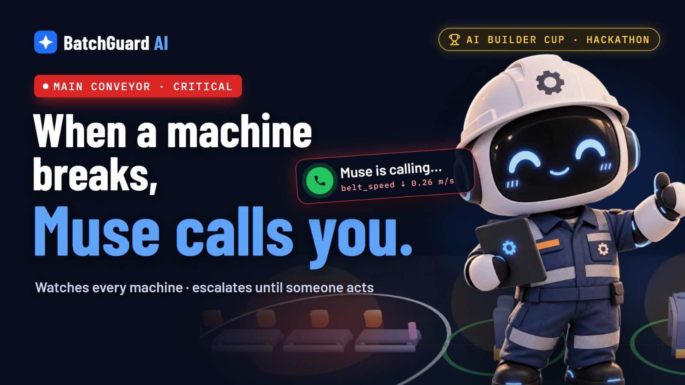
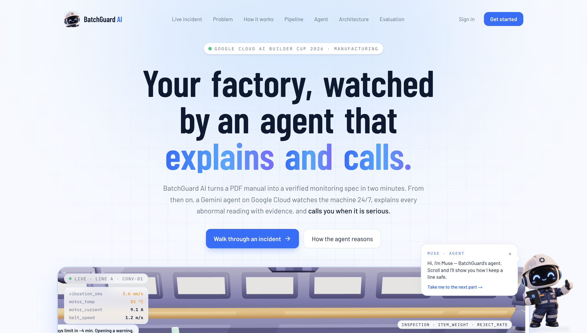
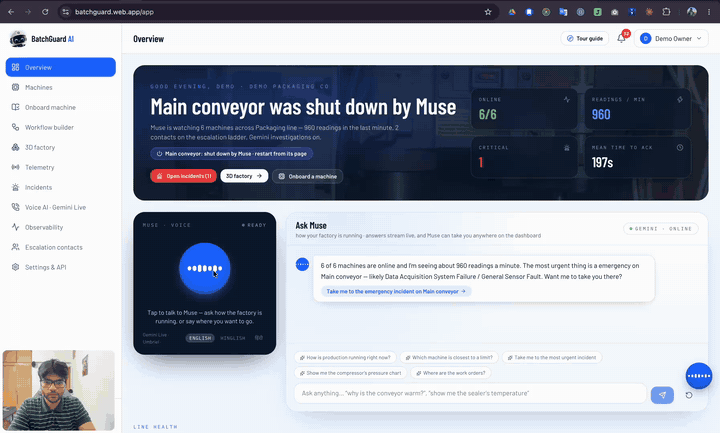
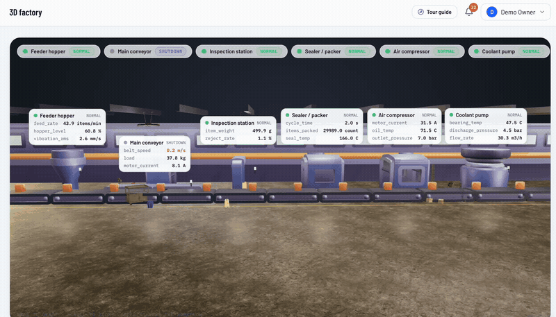
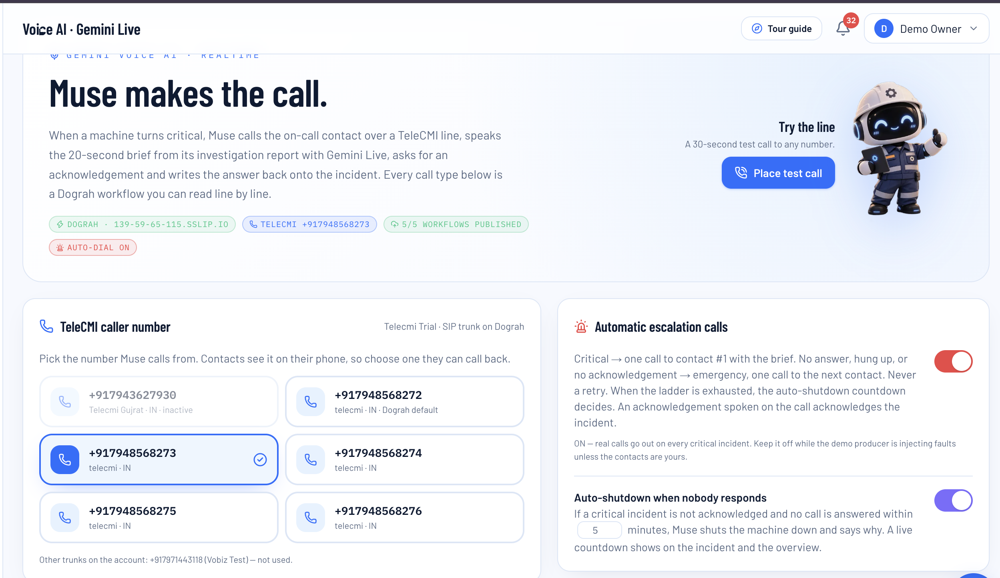
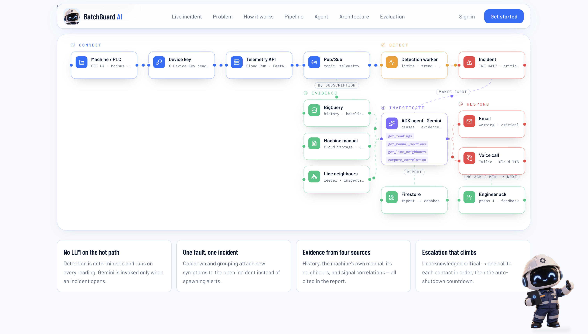
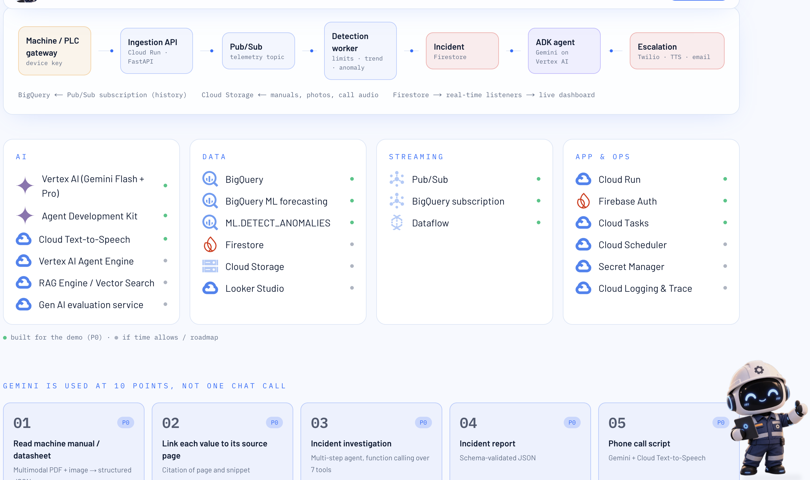

# BatchGuard AI

**Your factory, watched by an agent that explains and calls.**

Small factories run old machines with one stretched maintenance lead and nobody watching the line at 3 a.m. BatchGuard gives them **Muse**: an AI engineer that reads the machine's manual, watches every reading, works out what is going wrong, phones the right person, and shuts the machine down if nobody answers. You can also just talk to Muse and ask how the factory is doing.

Built for the **Google Cloud AI Builder Cup 2026 · Manufacturing** theme.

| | |
|---|---|
| **Live demo** | https://batchguardai.live (also https://batchguard.web.app) |
| **Sign in** | `demo@batchguard.ai` / `demo1234` (or "Continue with Google") |
| **Virtual factory** | https://sim.batchguardai.live — break a machine and watch Muse react |
| **Sample machine manual** | [Manual-pdf/CX-400_Conveyor_Manual.pdf](Manual-pdf/CX-400_Conveyor_Manual.pdf) — upload it on "Onboard machine" to see the extraction |
| **The problem and the idea** | [IDEA.md](IDEA.md) |
| **How it is built, end to end** | [SOLUTION.md](SOLUTION.md) |

> The demo account is pre-wired: six machines on a packaging line fed live by the virtual factory, Muse voice and chat, email through Resend, and real phone calls through Gemini Live. Auto-dial is on, so a critical incident really rings the on-call contact.

## Demo video (AI Builder Cup submission)

[](https://youtu.be/lxMaqhoitiU)

▶ **Watch the full demo:** https://youtu.be/lxMaqhoitiU



---

## See it in action

### Hands-off daily update: the owner asks Muse, Muse does the rest

Nobody clicks through pages. The owner taps the round voice button, asks "how is my factory running?", and Muse answers from live data, takes them to the incident, highlights the chart, and tells them whom it already called.

The animation below is a silent preview. **Click it to play the full 44-second video with Muse's voice.**

[](https://batchguardai.live/screenshots/handsfree.mp4)

▶ **Watch with sound:** [on the live site](https://batchguardai.live/screenshots/handsfree.mp4) · [in this repo](public/screenshots/handsfree.mp4) (GitHub opens a player; press play and make sure it is not muted)

### The live 3D factory

Every machine lights up with its real status. Lamps, labels and the conveyor follow the data in real time.



### Muse makes the call

When a machine turns critical, Muse phones the on-call contact over a TeleCMI line, explains the problem, the likely cause and the first check in plain words (English, Hindi or Hinglish), and takes the acknowledgement. Every call script is a workflow you can read line by line.



### How the pieces connect



### The stack



---

## What Muse does, step by step

1. **Reads.** Upload the machine's PDF manual. Gemini pulls out every parameter, unit and warning/critical limit with the page it came from. A person ticks "verified" and gets a device key and code samples.
2. **Watches.** The machine posts a reading every second to its own API. Limits, trends (time-to-limit), anomalies (z-score against the machine's own baseline) and staleness are checked on each reading with no LLM in the way.
3. **Investigates.** When something drifts, a Google ADK agent on Vertex AI gathers evidence (history, the manual, line neighbours, correlations), tests three to five explanations, ranks them and writes the first checks. Numbers in the report are guarded against the data.
4. **Calls.** If it turns critical, Muse emails once and phones the on-call contact with Gemini Live, reads a 20-second brief, answers "what happened?", and takes the acknowledgement.
5. **Protects.** If nobody acknowledges, Muse climbs the ladder one call per person, and after five minutes sends the machine a `shutdown` command. A live countdown shows on the incident and the overview; restart from the machine page after a check.
6. **Learns.** Photos, work orders, verdicts and fixes go back into the history the agent reads next time. A blind evaluation scoreboard scores detection and cause accuracy against injected faults.

---

## Features

| Area | What you get |
|---|---|
| Onboarding | PDF manual → Gemini extracts parameters, limits and knowledge with page citations → you verify → device key + code samples |
| Detection | Limits, trend with predicted time-to-limit, anomaly, staleness ("machine is down, no telemetry"), startup grace; one incident per machine, severity upgrades in place, auto-close "back to normal" |
| Investigation | ADK sequential pipeline: parallel evidence gathering → hypotheses → evaluation → checks → report, with a number guardrail |
| Muse copilot | ChatGPT-style streaming chat, realtime voice (Gemini Live, Indian voice, English / Hinglish / हिंदी), navigation that spotlights any part of the dashboard, live incident updates spoken as they happen |
| Muse can act | Edit escalation contacts, organisation details, machine names, parameter limits and work orders; acknowledge or resolve incidents; place calls; shut down or restart a machine; all by voice or chat |
| Escalation | One incident email per incident, one call per contact, never a retry; ladder exhausted → auto-shutdown countdown decides |
| Email | Resend with Muse-branded templates; the owner email from Settings receives the incident email when no contact has an address |
| Action | Photo evidence read by Gemini vision, work-order Kanban per machine, feedback loop on resolution |
| Visibility | Live 3D factory, workflow node builder with Muse watching the line, telemetry chart and paginated table, incidents with pagination, observability, blind evaluation |
| Tour | A step-by-step guided tour from the header, Overview to Settings |
| Simulator | Separate virtual factory app that streams telemetry into the demo account: dial parameters, inject faults, stop/start, add or remove machines |
| Performance | Always-on Cloud Run instances, CDN-cached 3D assets, skeleton loading everywhere, lazy-mounted sections |

---

## Escalation ladder (exactly what runs)

The order number on each contact is the ladder. Role is a label.

- **Info**: dashboard only.
- **Warning**: one email to the first contact on the ladder who has an email address (the owner email from Settings if nobody has one).
- **Critical**: the same single email, plus one call to contact #1 with the brief.
- **No answer, hung up, or talked without acknowledging**: as soon as that call ends, one call to the next contact. Nobody is called twice for the same incident. If no call can be placed at all, the ladder still moves every 2 minutes.
- **Ladder exhausted**: nothing more is dialled. After 5 minutes without an acknowledgement, Muse shuts the machine down and says so.
- **Acknowledgement** from the call, the dashboard, or Muse stops everything and cancels the countdown.

Everything else (reports, resolutions, call summaries, shutdowns) is recorded in the dashboard's notification list, not emailed.

---

## How Google Cloud is used

| Service | Where |
|---|---|
| **Gemini 2.5 Flash / Pro on Vertex AI** | Manual extraction with citations, the investigation agent, call-outcome extraction, photo evidence, Muse chat |
| **Google ADK** | The investigation pipeline (sequential agent with parallel evidence tools) |
| **Gemini Live** (`gemini-live-2.5-flash-native-audio`) | Muse's realtime voice on the dashboard and the phone calls (through Dograh over a TeleCMI SIP trunk) |
| **Cloud Run** | Backend (FastAPI + ADK), frontend (Next.js), simulator; all always-on with CPU boost |
| **Firebase Hosting** | batchguardai.live and sim.batchguardai.live in front of Cloud Run, with the CDN serving 3D models and UI assets |
| **Firebase Authentication** | "Continue with Google" |
| **Firestore** | Live mirror of machines, incidents, notifications, work orders, evidence and voice calls via SQLite triggers |
| **Cloud Storage** | Manuals, photos, and the SQLite snapshot that makes the single-instance database persistent |
| **Pub/Sub + BigQuery** | Telemetry stream and full reading history |
| **Cloud Scheduler** | Keep-alive pings so no instance ever goes cold |
| **Secret Manager, Cloud Build, Artifact Registry, Cloud Logging** | Secrets, image builds, image storage, structured logs |

---

## Repository layout

```
batchguard/
├── src/                      Next.js 16 frontend
│   ├── app/                  landing, login/signup, onboarding, /app/* dashboard pages
│   ├── components/app/       Shell, Tour, charts, WorkOrders, PhotoEvidence, ShutdownCountdown, LazySection
│   ├── components/muse/      MuseLive (chat + voice runtime), MuseConsole (Ask Muse, voice button)
│   ├── components/three/     3D factory (React Three Fiber), Muse character, HUD
│   └── lib/                  api.ts (typed client, SSE hook, cache), firebase.ts, machineTypes.ts
├── backend/                  FastAPI + Google ADK (Python 3.12)
│   ├── app/main.py           app, lifespan (sweepers, keep-alive, restore + sync), routers
│   ├── app/detection.py      limits / trend / anomaly / forecast
│   ├── app/ingest.py         shared ingestion path for /v1/telemetry
│   ├── app/incidents.py      incident lifecycle, escalation ladder, recovery sweep
│   ├── app/shutdown.py       auto-shutdown countdown and device commands
│   ├── app/notify.py         in-app, email and voice channels (one email per incident, one call per contact)
│   ├── app/mail.py           Resend client + Muse email templates
│   ├── app/cloud.py          Firestore / Pub/Sub / BigQuery / GCS / Logging adapters (fail-soft), SQLite snapshots
│   ├── app/agent/            adk_agent.py, tools.py, runner.py, extract.py (PDF), evidence.py (photos),
│   │                         muse_live.py (copilot + Gemini Live), muse_actions.py (what Muse can edit)
│   ├── app/voice/            dograh.py client, calls.py, scenarios.json, workflows/*.json (call scripts)
│   ├── app/routers/          auth, orgs, machines, device, incidents, misc, voice, work_orders, muse
│   └── scripts/              device_sample.py (reference device), trigger_fault.py
├── simulator/                virtual factory (Next.js): 3D plant, control panel, telemetry engine
├── public/screenshots/       the images and videos used above
├── deploy.sh                 ./deploy.sh [backend|frontend|simulator|all|keepalive|keepalive-off]
└── firebase.json             Hosting sites → Cloud Run
```

---

## Run locally

Prerequisites: Node 22+, Python 3.12, a Google Cloud project with Vertex AI enabled (or an AI Studio key), `gcloud` authenticated.

```bash
# 1. backend
cd backend
python3.12 -m venv .venv && .venv/bin/pip install -r requirements.txt
cp .env.example .env            # fill in the values below
.venv/bin/uvicorn app.main:app --reload --port 8000

# 2. frontend (new terminal, repo root)
npm install
cp .env.example .env.local      # BACKEND_URL=http://localhost:8000
npm run dev                     # http://localhost:3000

# 3. virtual factory (new terminal) — turn off the built-in producer first: DEMO_PRODUCER=false in backend/.env
cd simulator && npm install && cp .env.example .env.local && npm run dev   # http://localhost:3002
```

Sign in with `demo@batchguard.ai` / `demo1234`. With `DEMO_PRODUCER=true` and no simulator, the backend generates its own telemetry for the demo line and runs a bearing-wear fault cycle so incidents appear on their own.

### Backend environment (`backend/.env`)

| Variable | Purpose |
|---|---|
| `APP_URL`, `AUTH_SECRET`, `DATABASE_PATH`, `UPLOAD_DIR` | app basics |
| `GOOGLE_GENAI_USE_VERTEXAI=true`, `GOOGLE_CLOUD_PROJECT`, `GOOGLE_CLOUD_LOCATION=global` | Gemini on Vertex AI (or `GOOGLE_API_KEY` for AI Studio) |
| `GEMINI_MODEL_FAST`, `GEMINI_MODEL_PRO` | `gemini-2.5-flash`, `gemini-2.5-pro` |
| `GEMINI_LIVE_MODEL`, `GEMINI_LIVE_LOCATION`, `GEMINI_LIVE_VOICE`, `GEMINI_LIVE_LANGUAGE` | Muse realtime voice (`gemini-live-2.5-flash-native-audio`, `us-central1`, `Umbriel`, `hi-IN`) |
| `GCP_PROJECT`, `GCP_LOCATION`, `GOOGLE_APPLICATION_CREDENTIALS`, `FIRESTORE_DATABASE`, `BIGQUERY_DATASET`, `GCS_BUCKET`, `PUBSUB_TOPIC_TELEMETRY`, `CLOUD_LOGGING`, `DB_SNAPSHOT` | Google Cloud data services (all fail-soft when empty) |
| `FIREBASE_PROJECT_ID` | verify Google sign-in tokens |
| `RESEND_API_KEY`, `RESEND_FROM`, `EMAIL_ASSET_BASE` | email; empty key → emails recorded as "simulated" |
| `DOGRAH_BASE_URL`, `DOGRAH_API_KEY`, `DOGRAH_TELEPHONY_CONFIG_ID`, `DOGRAH_FROM_PHONE_NUMBER_ID`, `VOICE_AUTO_DIAL` | phone escalation through Dograh + TeleCMI |
| `KEEPALIVE_URLS` | `;`-separated URLs the backend pings every 30 s (production only) |
| `DEMO_MODE`, `DEMO_PRODUCER`, `STALE_AFTER_SECONDS`, `INCIDENT_COOLDOWN_SECONDS`, `ESCALATION_TIMEOUT_SECONDS`, `TREND_WINDOW_SECONDS` | demo and detection tuning |

### Frontend environment (`.env.local`)

`BACKEND_URL` (proxy target for `/api/*` and `/v1/*`), `NEXT_PUBLIC_BACKEND_URL` (backend origin the browser uses for the live stream, chat and voice websocket), `NEXT_PUBLIC_FIREBASE_*` (Google sign-in; optional).

---

## Try onboarding with the sample manual

Want to see the manual-to-spec step yourself? Use the conveyor manual in [Manual-pdf/CX-400_Conveyor_Manual.pdf](Manual-pdf/CX-400_Conveyor_Manual.pdf): sign in, open **Onboard machine**, upload the PDF, and Gemini returns the parameters, units and warning/critical limits with the page each one came from. Tick "verified" and the machine gets its device key and code samples. Any other machine manual works the same way.

---

## Connect a real machine

After onboarding, each machine page shows its endpoint, key and code samples. The minimum:

```bash
curl -X POST https://batchguard-backend-6our3ivvha-as.a.run.app/v1/telemetry \
  -H "X-Device-Key: bg_live_..." -H "Content-Type: application/json" \
  -d '{"device_id":"main-conveyor-41y","readings":[{"parameter":"motor_temp","value":71.2,"unit":"C"}]}'
```

Readings are validated against the verified spec (unknown parameters and mismatched units are rejected), de-duplicated by `reading_id`, and answered with the detection signals they produced. Devices also poll `GET /v1/commands?device_id=…` (same key) for `shutdown` / `start` commands and acknowledge them with `POST /v1/commands/{id}/ack`; the simulator does this every 3 s. `backend/scripts/device_sample.py` is a reference device; `trigger_fault.py` injects a bearing-wear ramp.

---

## Talking to Muse

On the overview, **Ask Muse** gives a live greeting and a chat that streams token by token. The round voice button follows you on every page; tap it for a realtime conversation in English, Hinglish or Hindi. Muse navigates and highlights the exact spot in yellow while it keeps talking, and it edits things when you ask:

- "How is production running right now?"
- "Take me to the most urgent incident"
- "Show me the compressor's pressure chart"
- "Add Prabal Verma as the first contact, number 94584 89735"
- "Raise the conveyor's motor temperature warning to 82"
- "Call the supervisor about the sealer"
- "Shut the coolant pump down" / "Cancel the countdown"

Whenever Muse reports a critical incident it says whom it called and how that went. The voice websocket connects straight to the backend origin, so the browser must reach `NEXT_PUBLIC_BACKEND_URL`.

---

## Voice escalation (phone)

`/app/voice` lists five call types as Dograh workflows (JSON in `backend/app/voice/workflows`), lets you pick a TeleCMI caller number, publish the workflows, place a test call with a condition preset, and review call history with transcripts, recordings and the extracted outcome. When the person on the phone asks "what happened?", the agent explains the problem, the likely cause and the first check before pointing to the dashboard. An acknowledgement spoken on the call acknowledges the incident; a follow-up call's verdict resolves it. Auto-dial and auto-shutdown are per organisation.

---

## Virtual factory simulator

A separate app (`simulator/`, its own Cloud Run service and Hosting site) that behaves like a plant's PLC gateway for the demo account. It signs in as the demo owner, obtains a device key per machine, and streams telemetry to `POST /v1/telemetry` every second, exactly like a device would. The 3D plant on the page is the simulated factory; the control panel lets you:

- drag any parameter to a target value over a chosen ramp time,
- inject fault presets (bearing wear, overload, belt slip, pressure drop, cavitation, seal overheat, feed starvation, reject spike, slow drift),
- stop a machine (telemetry stops → BatchGuard reports it down) and start it again,
- change production speed, add machines of any type or remove them,
- watch what BatchGuard said back for each post in the live log.

It also executes `shutdown` and `start` commands from BatchGuard, so the auto-shutdown really stops the virtual machine.

---

## Deploy to Google Cloud

```bash
# one-time
gcloud auth login && gcloud config set project <PROJECT>
printf '%s' "$DOGRAH_API_KEY" | gcloud secrets create batchguard-dograh-key --data-file=-
printf '%s' "$RESEND_API_KEY" | gcloud secrets create batchguard-resend-key --data-file=-
echo <PROJECT> > backend/.gcp-project

# every release
./deploy.sh all          # backend, frontend, simulator (each always-on, one instance) + Firebase Hosting
./deploy.sh keepalive    # Cloud Scheduler pings every service each minute
```

`deploy.sh` builds the images with Cloud Build, pushes them to Artifact Registry, deploys to Cloud Run, wires the frontend to the backend URL and the backend to the public app URL, and publishes the Firebase Hosting rewrites.

**Data.** SQLite is the primary database and it persists on Cloud Run: an incremental snapshot (last hour of readings; BigQuery keeps the full history) is uploaded to Cloud Storage every few minutes when something changed and on shutdown, with hourly backups, and a fresh container restores the latest snapshot before serving. Firestore mirrors the collections other clients care about within seconds via SQLite triggers.

**Custom domain.** `batchguardai.live`, `www` and `sim` are Firebase Hosting custom domains in front of the Cloud Run services; email is sent from `muse@batchguardai.live` through a Resend-verified domain. Any new hostname must be added to the backend CORS rule, because the browser calls the backend origin directly.

### Keeping the demo warm (no cold starts)

All three services run with `--min-instances 1`, `--no-cpu-throttling` and `--cpu-boost`. Cloud Scheduler jobs `keepalive-*` ping each service and both Hosting sites every minute, and the backend pings the dashboard and simulator every 30 s. Tear down in this order when the demo is over:

```bash
./deploy.sh keepalive-off
gcloud run services delete batchguard-simulator --region asia-southeast1
gcloud run services delete batchguard-frontend  --region asia-southeast1
gcloud run services delete batchguard-backend   --region asia-southeast1   # last: it snapshots SQLite to Cloud Storage on shutdown
```

---

## Testing and quality

```bash
npm run lint && npx tsc --noEmit && npm run build     # frontend
cd backend && .venv/bin/python -m compileall app        # backend
```

Blind evaluation: on Settings, record an injected fault, run `trigger_fault.py`, and the scoreboard reports detection, delay and top-1/top-3 cause accuracy for the first report that follows.

---

## Credits

Kenney Factory Kit (CC0) · Poly Haven HDRIs and textures (CC0) · machine photos from Wikimedia Commons (see `public/machines/credits.json`) · Simple Icons.

BatchGuard AI is advisory only. Recommendations are for qualified personnel following site safety and lockout procedures.
